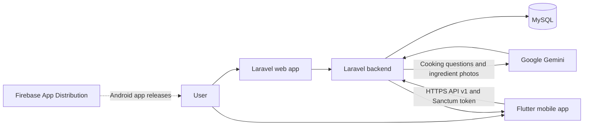

# TuklasFood

TuklasFood is a recipe and kitchen-management application with a Laravel web app and a Flutter mobile app. Users can explore recipes, manage a personal pantry and kitchen tools, chat with a cooking assistant, and scan ingredient photos for meal recommendations.

## System flow



### Mobile sign-in and kitchen

1. The Flutter app sends sign-in or registration details to Laravel.
2. Laravel validates the account and returns a Sanctum bearer token.
3. The app uses the token to load published recipes, ingredients, equipment, the user’s pantry, and selected tools.
4. Pantry and equipment changes are validated and stored in MySQL for the signed-in user.

### Ingredient photo scan

1. The user takes or selects up to four photos and may add a note such as “I have potatoes, chili, and flour.”
2. Flutter sends the photos and note to the authenticated Laravel API. The API validates image type, size, dimensions, and count.
3. Laravel sends the photos, note, and recipe instructions to Gemini. The AI distinguishes user-reported ingredients from visually identified items and suggests cookable meals with quantities, servings, tools, times, and steps.
4. Laravel saves successful scan results to MySQL, linked to the signed-in user. The original photos are not stored.
5. The app displays the recipes and can load that user’s 20 most recent saved recommendations.

### Cooking chat

The Flutter chat sends a message and up to ten recent conversation turns to Laravel. Laravel adds cooking instructions and published recipe context, calls Gemini, and returns the reply. Chat history currently stays in the app session and is not stored in MySQL.

## Full flow documentation

See [SYSTEM_FLOW.md](SYSTEM_FLOW.md) for detailed diagrams, web and mobile flows, API routes, database tables, and deployment layout.

## Main technologies

- **Web and API:** Laravel, PHP, Sanctum, Fortify/Jetstream
- **Mobile:** Flutter and Dart
- **Database:** MySQL
- **Ingredient recognition and cooking assistant:** Google Gemini API, called server-side by Laravel
- **Android app distribution:** Firebase App Distribution
- **Hosting:** AWS EC2 with Ubuntu, Nginx, and PHP-FPM

## Run locally

### Laravel backend

Requirements include PHP 8.5.12 or compatible with the project constraints, Composer, Node.js compatible with the version requirements in `package.json`, and MySQL.

```bash
composer install
cp .env.example .env
php artisan key:generate
```

Set the local MySQL connection in `.env`, then configure the server-side Gemini settings (`AI_PROVIDER`, `AI_API_KEY`, and `AI_TEXT_MODEL`). Keep the API key private; do not add it to Flutter or commit it.

```bash
php artisan migrate --seed
npm install
npm run build
php artisan serve
```

### Flutter mobile app

Install Flutter and Android Studio, then from the `mobile` folder run:

```bash
flutter pub get
flutter run --dart-define=API_BASE=http://10.0.2.2:8000/api/v1
```

`10.0.2.2` is the Android emulator alias for the host computer. For a physical device, set `API_BASE` to a server address reachable over the network. Firebase platform configuration files are required for Firebase initialization.

## API overview

Mobile API base path: `/api/v1`. Protected routes require `Authorization: Bearer <token>`.

| Method | Endpoint | Purpose |
| --- | --- | --- |
| POST | `/auth/login` | Sign in and issue a mobile token |
| POST | `/auth/register` | Create an account and issue a token |
| POST | `/auth/forgot-password` | Request a password reset |
| DELETE | `/auth/token` | Revoke the current token |
| GET | `/kitchen` | Load recipes and the user’s kitchen data |
| POST | `/ingredient-scan` | Scan photos and save recommendations |
| POST | `/ingredient-scale` | Compatibility alias for ingredient scanning |
| GET | `/recommendations` | Load the current user’s latest saved scans |
| POST / PUT / DELETE | `/pantry` and `/pantry/{item}` | Manage pantry entries |
| PUT | `/equipment` | Save selected kitchen tools |
| POST | `/cooking-chat` | Send a cooking chat turn |

## Data and privacy notes

- Pantry entries, equipment selections, accounts, recipe catalog data, and saved scan results are stored in MySQL.
- Saved AI recommendations are scoped to the account that created them.
- Ingredient images are transmitted to Gemini for analysis and are not saved as image files by this application.
- The Gemini API key belongs on the Laravel server and must never be embedded in the mobile app or committed to Git.

## Tests

Run the Laravel test suite with:

```bash
php artisan test
```

For Flutter static analysis, from `mobile` run:

```bash
flutter analyze
```
