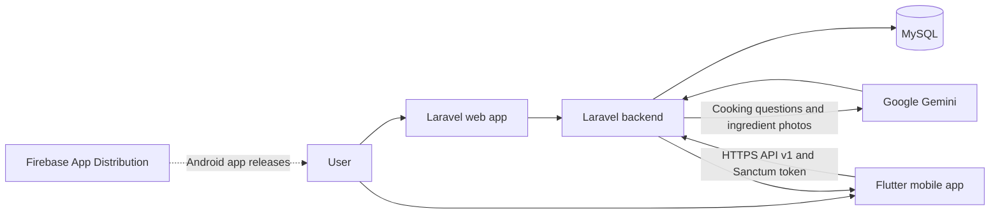
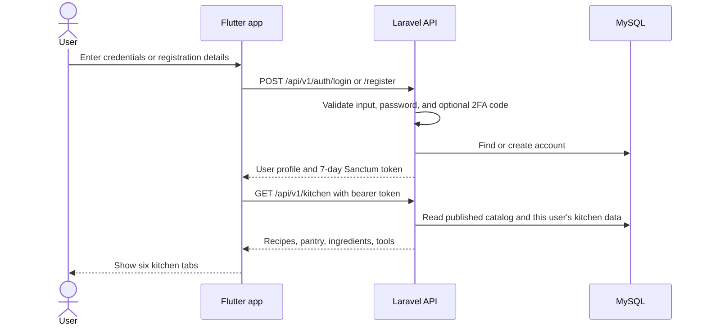
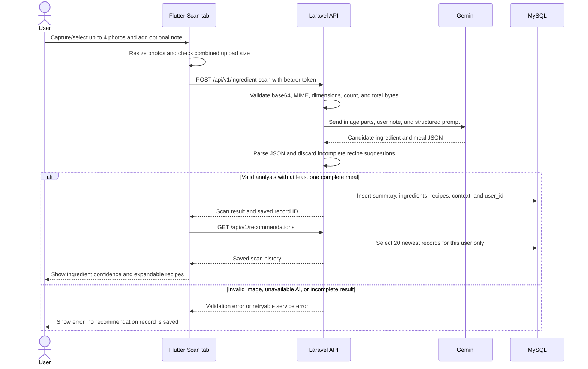

# TuklasFood

TuklasFood is a recipe and kitchen-management application with a Laravel web app and a Flutter mobile app. Users can explore recipes, manage a personal pantry and kitchen tools, chat with a cooking assistant, and scan ingredient photos for meal recommendations.

## System flow



### Mobile sign-in and kitchen



The app keeps the returned token in its current runtime and adds it to protected API calls. When Laravel returns `401`, the app clears that token and returns to sign-in. Registration and login share Laravel validation; accounts with confirmed two-factor authentication must include a valid authenticator code. Password reset requests are handled by Laravel.

The signed-in home has **Recipes, Pantry, Scan, Tools, Chat, and Account** tabs. Refreshing the kitchen requests the published catalog and the authenticated user’s pantry/equipment from Laravel. Recipe search and availability filtering are performed in Flutter using this response.

### Recipe discovery and cooking

1. The recipe catalog is maintained in MySQL: `recipes` holds title, cuisine, serving count, time, difficulty, and publication state. `recipe_ingredients`, `recipe_steps`, and `recipe_equipment` hold its quantities, ordered directions, and tool requirements.
2. Laravel sends only published recipes to the web landing page and mobile kitchen response, with related ingredients, steps, and equipment loaded for display.
3. The user searches or filters recipes in the app. For each recipe, Flutter compares required ingredient base quantities with pantry stock and excludes expired stock. It compares equipment groups against the user’s selected tools; a group is satisfied if the user owns any tool in that group.
4. The recipe card reports whether the recipe is ready or what ingredients/tools are missing. Opening a recipe shows its quantities and directions; cooking mode presents the steps in sequence and supports the saved step timers while the app remains open (no background alarm is scheduled).

### Pantry and kitchen tools

1. The user selects an ingredient from Laravel’s reference ingredient list and enters quantity, unit, and optional purchase/expiration/storage details.
2. Flutter sends a create, update, or delete request. Laravel validates the fields and confirms that a record being changed belongs to the signed-in user.
3. Laravel converts the entered amount to the ingredient’s base unit (grams, milliliters, or pieces) and stores both the entered and normalized quantities in `user_ingredients`.
4. Tool selections are sent as a list of equipment IDs. Laravel validates the IDs and syncs the `equipment_user` pivot rows for that user.
5. The app refreshes its kitchen payload so recipe readiness reflects the saved changes.

### Ingredient photo scan



The client resizes photos before upload. Laravel re-checks image bytes rather than trusting the filename or client MIME declaration. It accepts JPEG, PNG, and WebP; one to four images; dimensions up to 4096 pixels per side; and 3 MB combined decoded image data. Requests are rate limited. The `/ingredient-scale` endpoint is a compatibility alias for the same scanner.

Gemini is prompted to separate ingredients visually confirmed in the photos from ingredients the user only reported in the note. It should avoid guessing uncertain items. Each returned recipe should have a serving count, realistic measured quantities, prep/cook time, tools, optional extras, and 4–8 steps. The backend checks the response structure, drops recipes with fewer than three steps or incomplete ingredient quantities, and caps the response size before saving or returning results. A scan record belongs to `user_id`; original image bytes are not persisted by TuklasFood.

The Scan tab loads saved recommendations when opened and refreshes the history after a successful scan. The API only returns the signed-in user’s latest 20 results. If the AI request fails, the API responds with an error and does not save a successful scan record.

### Cooking chat

1. The user writes a question or chooses one of the suggested prompts in the Chat tab.
2. Flutter sends the current message and up to ten recent turns to `POST /api/v1/cooking-chat` with the Sanctum token.
3. Laravel validates the message/history, loads a limited list of published recipe titles, and supplies cooking-specific system instructions to Gemini.
4. Gemini returns a natural-language answer. When the user asks for recipes, the prompt requests varied ideas and names which ingredients are used or missing. When the user asks how to cook one, it requests serving size, measured quantities, tools, times, and numbered steps.
5. Laravel returns the reply as JSON and Flutter appends it to the visible conversation.

Chat history is held in the mobile screen’s memory and sent back with the next message; Laravel does not currently save chat turns in MySQL. If the API key is missing or Gemini is unavailable, Laravel returns a service error and the app shows the request error instead of inventing an answer.

### Web browsing and account flow

1. A visitor opens `/`. Laravel loads published recipes and their ingredients, steps, and equipment for the public page.
2. The visitor can browse the catalog and use the public web cooking-chat route, which is rate limited.
3. The user signs in or registers through Laravel Fortify/Jetstream. Laravel authenticates the session and redirects successful users to `/dashboard`.
4. `/dashboard` requires authentication and verified email. Laravel loads published recipes plus pantry and equipment counts for the active user.
5. Demo sign-in routes are separately gated: they are available in local development or when the server explicitly enables `DEMO_LOGIN_ENABLED`.

## Full flow documentation

See [SYSTEM_FLOW.md](SYSTEM_FLOW.md) for detailed diagrams, web and mobile flows, API routes, database tables, and deployment layout.

## Main technologies

- **Web and API:** Laravel, PHP, Sanctum, Fortify/Jetstream
- **Mobile:** Flutter and Dart
- **Database:** MySQL
- **Ingredient recognition and cooking assistant:** Google Gemini API, called server-side by Laravel
- **Android app distribution:** Firebase App Distribution
- **Hosting:** AWS EC2 with Ubuntu, Nginx, and PHP-FPM

## Run locally

### Requirements

- PHP 8.5.12 or a version allowed by `composer.json`, Composer, and MySQL
- Node.js 22.12 or newer and npm for Laravel's Vite assets
- Flutter with Dart 3.13.4 or newer, plus Chrome, for the Flutter web app

### Clone and install dependencies (Windows PowerShell)

```powershell
git clone https://github.com/acheronibalogney/tuklasfood.git
cd tuklasfood
composer install
Copy-Item .env.example .env
php artisan key:generate
npm install
npm run build
```

`npm install` is used because it can reconcile the lockfile if package versions need updating. `npm run build` builds the Laravel Blade/Vite assets; the Flutter web app is run separately below.

### Configure MySQL

Start your local MySQL server, then create the application database. This command prompts for the MySQL account password:

```powershell
mysql -u root -p -e "CREATE DATABASE tuklas_food CHARACTER SET utf8mb4 COLLATE utf8mb4_unicode_ci;"
```

Edit `.env` and set `DB_CONNECTION=mysql`, `DB_HOST=127.0.0.1`, `DB_PORT=3306`, `DB_DATABASE=tuklas_food`, `DB_USERNAME`, and `DB_PASSWORD` to credentials that can access that database. Do not commit `.env` or share its password. Set `AI_PROVIDER`, `AI_API_KEY`, and `AI_TEXT_MODEL` on the Laravel server only if you want the AI features; registration does not require an AI key.

Run the migrations and load the recipe/reference catalog:

```powershell
php artisan migrate
php artisan db:seed --class='Database\Seeders\ReferenceDataSeeder'
php artisan db:seed --class='Database\Seeders\RecipeSeeder'
```

### Run the Flutter web app on localhost

From the `mobile` folder, run the Flutter web app in Google Chrome:

```powershell
cd mobile
flutter pub get
flutter run -d chrome
```

Flutter opens the app in Chrome and prints its localhost URL. The default web API address is the TuklasFood EC2 API. For registration to work, the server must be reachable, have a valid HTTPS certificate, and allow the localhost origin in CORS. Laravel—not Flutter—writes account data to MySQL.

To use a local Laravel API and MySQL instead, first start Laravel in **PowerShell terminal 1** at the repository root:

```powershell
php artisan serve --host=127.0.0.1 --port=8000
```

Then run Flutter from `mobile` in **PowerShell terminal 2** with this API override:

```powershell
flutter run -d chrome --web-hostname 127.0.0.1 --web-port 5180 --dart-define=API_BASE=http://127.0.0.1:8000/api/v1
```

The local Laravel CORS configuration allows localhost preview ports 5180 and 5181.

### Run the Flutter mobile app

From the `mobile` folder, run:

```powershell
flutter pub get
flutter run --dart-define=API_BASE=http://10.0.2.2:8000/api/v1
```

`10.0.2.2` is the Android emulator alias for the host computer. For a physical device, set `API_BASE` to an API server address reachable from that device. Firebase platform configuration files are required for native Firebase initialization; Flutter Web does not require them for registration.

## API overview

Mobile API base path: `/api/v1`. Protected routes require `Authorization: Bearer <token>`.

| Method | Endpoint | Purpose |
| --- | --- | --- |
| POST | `/auth/login` | Sign in and issue a mobile token |
| POST | `/auth/register` | Create an account and issue a token |
| POST | `/auth/forgot-password` | Request a password reset |
| DELETE | `/auth/token` | Revoke the current token |
| GET | `/kitchen` | Load recipes and the user’s kitchen data |
| POST | `/ingredient-scan` | Scan photos and save recommendations |
| POST | `/ingredient-scale` | Compatibility alias for ingredient scanning |
| GET | `/recommendations` | Load the current user’s latest saved scans |
| POST / PUT / DELETE | `/pantry` and `/pantry/{item}` | Manage pantry entries |
| PUT | `/equipment` | Save selected kitchen tools |
| POST | `/cooking-chat` | Send a cooking chat turn |

## Data and privacy notes

- Pantry entries, equipment selections, accounts, recipe catalog data, and saved scan results are stored in MySQL.
- Saved AI recommendations are scoped to the account that created them.
- Ingredient images are transmitted to Gemini for analysis and are not saved as image files by this application.
- The Gemini API key belongs on the Laravel server and must never be embedded in the mobile app or committed to Git.

## Tests

Run the Laravel test suite with:

```bash
php artisan test
```

For Flutter static analysis, from `mobile` run:

```bash
flutter analyze
```
