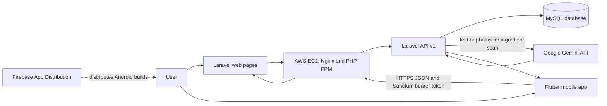
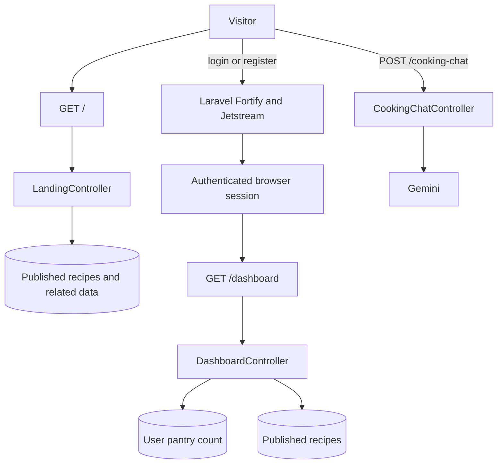
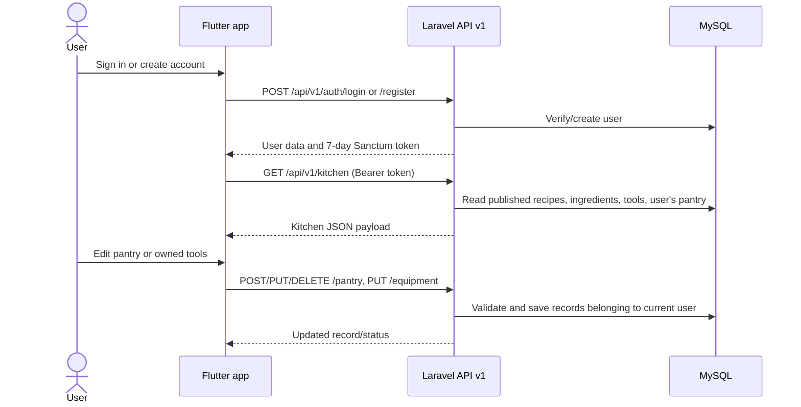
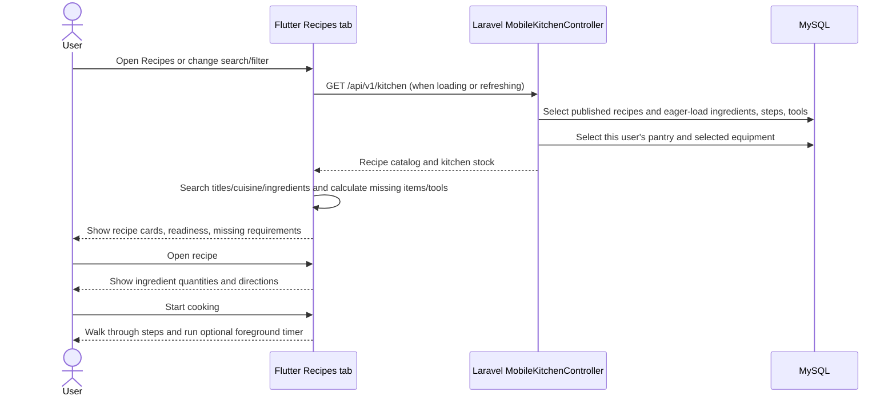
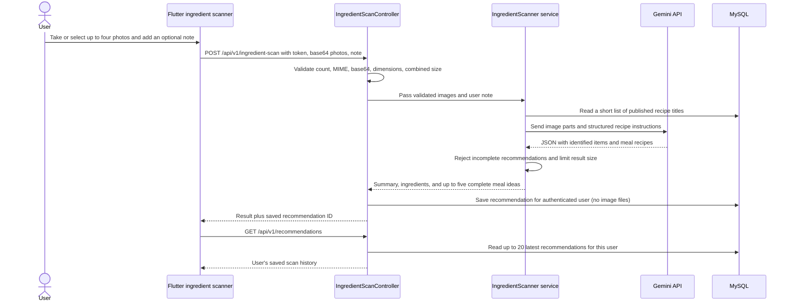
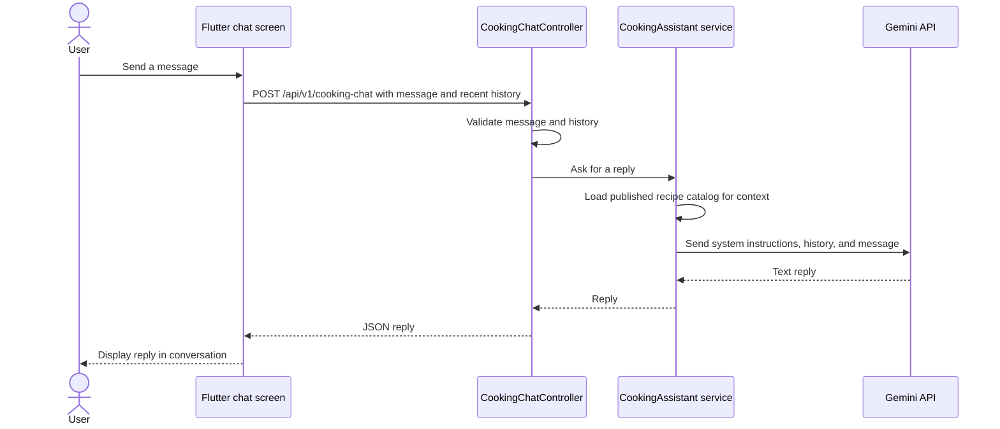

# TuklasFood System Flow

This document describes the current web, mobile, API, AI, and database flows in the repository. It is based on the Laravel routes and controllers and the Flutter screens in `mobile/lib`.

## System overview

The Laravel application is the backend for both web and mobile. The Flutter app sends requests to Laravel; it does not call Gemini directly. AI credentials remain in the Laravel environment/configuration and are not embedded in the mobile app.

## Web flow

- `GET /` renders the public landing page and published recipes.
- Browser authentication uses Laravel Fortify/Jetstream routes and session authentication.
- `GET /dashboard` requires authentication and email verification. It shows the signed-in user’s pantry/equipment counts and published recipes.
- `POST /cooking-chat` is rate limited and sends the message and supplied chat history to the cooking assistant.
- Demo login routes exist only when the app is local or `APP_DEMO_LOGIN_ENABLED` is enabled. They are not the normal account flow.

## Mobile account and kitchen flow

The mobile app initializes Firebase Core, then displays its own sign-in/registration screen. Laravel handles authentication and issues a Sanctum personal access token. The app sends that token as `Authorization: Bearer ...` on protected API requests. Mobile login also accepts a six-digit authenticator code when the account has confirmed two-factor authentication enabled. Password reset is requested through Laravel.

`GET /api/v1/kitchen` returns the current user, published recipes (including recipe ingredients, steps, and equipment), reference ingredients/equipment, that user’s pantry, and the IDs of the user’s selected equipment. Pantry create/update/delete operations are scoped through the authenticated user’s inventory relationship. The equipment endpoint synchronizes the authenticated user’s selections.

Mobile routes are defined in `routes/api.php` and are protected by `auth:sanctum` and rate limits where applicable.

## Recipe discovery and cooking workflow

Recipe catalog rows and their ingredient quantities, directions, and tool requirements are maintained separately in `recipes`, `recipe_ingredients`, `recipe_steps`, and `recipe_equipment`. The mobile kitchen API only returns recipes marked published, along with related records so the app can render full recipe details without additional per-recipe requests.

The Flutter client compares each required recipe ingredient's normalized quantity (`quantity_base`) with the sum of the user's non-expired pantry stock for that ingredient. Optional recipe ingredients do not make a recipe unavailable. For equipment, recipes may define alternative tools in the same `group_no`; a requirement is met if the user selected any tool from each group. The app uses those calculations to show readiness and missing ingredients/tools, and lets users filter to recipes marked ready. These calculations use the most recently loaded kitchen data; refreshing reloads current server data. Recipe step timers run while the app is open and do not schedule a background alarm.

## Ingredient photo scan and saved recommendations

The scanner accepts one to four JPEG, PNG, or WebP images and an optional note. Server-side validation checks that uploaded bytes match their declared image type, rejects invalid/oversized images, enforces a 4096-pixel dimension limit, and limits combined photo bytes to 3 MB. The mobile app resizes photos before sending them.

The note can name ingredients that are not visible in a photo. Gemini instructions tell the model to mark those as user-reported, distinguish them from visually confirmed ingredients, and avoid claiming that uncertain foods were seen. The model is asked for up to five distinct meal ideas with servings, quantities and units, time, tools, optional pantry extras, and numbered cooking steps. Incomplete meal suggestions are discarded by the backend.

Successful scans are stored in `ai_recommendations` with `user_id`, summary, ingredient JSON, meal-idea JSON, optional context, and timestamps. Original photos are sent to Gemini for analysis but are not written into this table or stored as uploaded files. The recommendations endpoint returns only the current authenticated user’s latest 20 records.

## Casual cooking chat flow

The mobile chat keeps its conversation in screen memory and sends up to ten recent turns with each request; the chat messages are not persisted to MySQL by the current chat endpoint. The assistant supports casual conversation and cooking help. For meal suggestions it is instructed to include ingredients used and missing extras, and to give measured quantities, serving count, times, tools, and numbered steps when the user asks how to cook a dish.

The web `POST /cooking-chat` route uses the same controller/service as mobile, but does not use the mobile API route prefix.

## Main database records

| Table | Purpose |
| --- | --- |
| `users` | Web and mobile accounts, role, verification, and two-factor fields |
| `personal_access_tokens` | Hashed Sanctum tokens issued to mobile clients |
| `ingredient_categories` | Ingredient classification reference data |
| `ingredients` | Ingredient names, categories, base units, and optional parent ingredient |
| `user_ingredients` | Per-user pantry quantities, dates, and storage location |
| `equipment` | Kitchen tool reference data |
| `equipment_user` | Tools selected by each user |
| `recipes` | Published recipe catalog and serving/time metadata |
| `recipe_ingredients` | Recipe ingredient quantities and optional flags |
| `recipe_steps` | Ordered recipe instructions and optional timers |
| `recipe_equipment` | Tools required by recipes, grouped by alternatives |
| `ai_recommendations` | Per-user saved AI scan summary, ingredients, meal ideas, and note (no photo blobs) |

## API route summary

All routes below are under `/api` as registered by Laravel; versioned mobile routes use `/api/v1`.

| Method | Path | Authentication | Purpose |
| --- | --- | --- | --- |
| POST | `/api/v1/auth/login` | Public, rate limited | Issue a mobile token |
| POST | `/api/v1/auth/register` | Public, rate limited | Register and issue a token |
| POST | `/api/v1/auth/forgot-password` | Public, rate limited | Request reset email |
| DELETE | `/api/v1/auth/token` | Sanctum | Revoke the current mobile token |
| GET | `/api/v1/kitchen` | Sanctum | Load kitchen data |
| POST | `/api/v1/ingredient-scan` | Sanctum, rate limited | Analyze ingredient photos and save results |
| POST | `/api/v1/ingredient-scale` | Sanctum, rate limited | Compatibility alias for ingredient scan |
| GET | `/api/v1/recommendations` | Sanctum | Load the user’s recent saved scan results |
| POST / PUT / DELETE | `/api/v1/pantry[/{item}]` | Sanctum | Manage the user’s pantry |
| PUT | `/api/v1/equipment` | Sanctum | Save selected equipment |
| POST | `/api/v1/cooking-chat` | Sanctum, rate limited | Send a mobile cooking chat turn |
| POST | `/cooking-chat` | Public, rate limited | Get a web cooking assistant reply |

## Deployment and external services

The deployed layout used for this project is AWS EC2 running Ubuntu, with Nginx serving Laravel’s `public` directory and PHP-FPM executing PHP requests. Laravel uses MySQL for application records. The Gemini key/model are configured on the server through environment-backed Laravel configuration. Do not put the Gemini key in Flutter, Firebase configuration, or a checked-in file.

Firebase App Distribution is used to distribute Android APK builds to testers. Firebase Core is initialized in the Flutter app; API authentication, pantry data, and AI requests are handled by Laravel.

## Source map

- Web routes: `routes/web.php`
- Mobile API routes: `routes/api.php`
- Mobile authentication and kitchen endpoints: `app/Http/Controllers/MobileAuthController.php`, `app/Http/Controllers/MobileKitchenController.php`
- AI scan and saved-history endpoints: `app/Http/Controllers/IngredientScanController.php`, `app/Http/Controllers/AiRecommendationController.php`
- AI integrations: `app/Support/IngredientScanner.php`, `app/Support/CookingAssistant.php`
- Flutter app entry and screens: `mobile/lib/main.dart`, `mobile/lib/auth_screen.dart`, `mobile/lib/home_screen.dart`, `mobile/lib/ingredient_scanner_screen.dart`, `mobile/lib/chat_screen.dart`
- MySQL schema: `database/migrations/`
